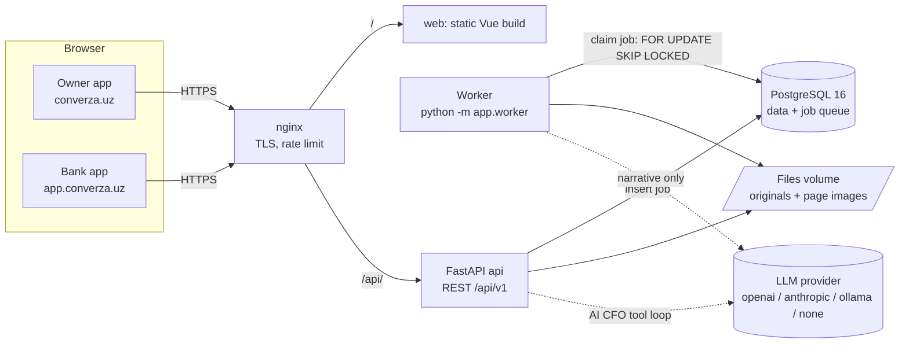
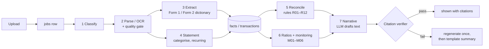
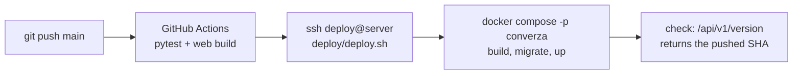

# Converza: how it is built

This is a short tour of the codebase for the jury. For more detail, see [`docs/plan/01-ARCHITECTURE.md`](plan/01-ARCHITECTURE.md) (components and the full data model) and [`docs/plan/02-PIPELINE.md`](plan/02-PIPELINE.md) (stages, rules, verifier).

**In one sentence:** a Vue web app talks to a FastAPI backend, which stores everything in PostgreSQL. A separate worker process takes uploaded documents from a job queue in Postgres and runs them through a pipeline of mostly deterministic stages. The language model only writes text, and a verifier checks every number in that text against the records.

---

## 1. The big picture



| Part | What it does |
|---|---|
| **web** | One Vue 3 build that serves two apps. The hostname picks which one: `app.converza.uz` is the bank officer app and `converza.uz` is the business owner app. |
| **api** | FastAPI. Handles sign-in, uploads, reading results, officer actions (review, decision) and the AI CFO question loop. It never parses documents itself; it adds a row to the `jobs` table. |
| **worker** | The same Docker image started with a different command. It polls `jobs`, claims one with `SELECT … FOR UPDATE SKIP LOCKED` and runs the pipeline. Jobs run in child **processes**, because pdfium and Tesseract are not thread-safe. A heartbeat file feeds the container healthcheck. |
| **db** | PostgreSQL 16 holds all the data, the job queue and the audit log. We do not use Redis or any other message broker. |
| **files** | A Docker volume containing each original upload and a 150-dpi PNG of every page. The evidence pane draws its highlight on top of these PNGs. |

**Why the job queue is in Postgres:** it means one fewer service to run and keep healthy. Jobs survive a restart. A crashed job is picked up again when its lock goes stale (`WORKER_STALE_LOCK_S`). The UI reads the job's `stage` and `progress` straight from the same row, so the progress you see is the real progress.

---

## 2. Languages and stack

| Layer | Language | Main libraries |
|---|---|---|
| Backend | **Python 3.12** (managed with `uv`, locked in `uv.lock`) | FastAPI, SQLAlchemy 2, Alembic, Pydantic 2, PyJWT, pwdlib (Argon2) |
| Document reading | Python | `pdfplumber` (PDF text layer), `pypdfium2` (page rendering), Tesseract 5 through `pytesseract` with OpenCV clean-up (scans and photos), `openpyxl` / `xlrd` (Excel) |
| Matching and ML | Python | `rapidfuzz` (fuzzy matching of row labels), `scikit-learn` (TF-IDF + logistic regression that sorts bank-statement transactions into categories) |
| LLM | Python | `openai` SDK; Anthropic Messages API over `httpx`; Ollama through its OpenAI-compatible endpoint |
| Frontend | **TypeScript + Vue 3** | Vite, vue-router, Pinia. Plain CSS with design tokens. Charts are hand-written inline SVG, with no chart library. |
| Database | SQL | PostgreSQL 16 in production; SQLite in memory for the tests |
| Infrastructure | YAML / shell | Docker Compose, nginx, GitHub Actions |

**Languages the product handles:**
- **Interface:** English, Russian and Uzbek, switchable in the UI (`web/src/i18n`). If a translation is missing, the English text is shown.
- **Documents:** Uzbek Latin, Uzbek Cyrillic, Russian and English. The classifier detects the language. OCR runs with the `uzb`, `uzb_cyrl`, `rus` and `eng` language packs.

---

## 3. Repository layout

```
app/
  main.py              FastAPI app: routers, error handlers, /health
  worker.py            job worker (Postgres queue, process pool)
  core/                config, DB session, base model, JWT + password hashing, scopes, AppException
  modules/<feature>/   models.py · schemas.py · service.py · router.py   (one folder per feature)
  pipeline/            pure functions: classify → parse/OCR → extract → reconcile → ratios → narrative → verify
    dictionary/forms.yaml   Form 1 / Form 2 line codes (checked against the official templates on lex.uz)
    rules/                  reconciliation rules R01–R12
    statements/             bank-statement normalisation, categoriser model, recurring-payment detection
  alembic/versions/    database migrations
  seed_demo.py         pushes the synthetic demo files through the real pipeline
web/src/
  pages/owner/         Home, Upload, AI CFO, Budget, Apply
  pages/bank/          Portfolio, Applications, Loan review, Borrowers, Borrower profile
  components/evidence/ evidence pane: click a number to see its page with the cell highlighted
  components/charts/   inline SVG charts
  api/, stores/, i18n/
eval/                  synthetic document generator, evaluation runner, results JSON
tests/                 pytest suite (SQLite in memory)
deploy/                deploy.sh + nginx vhost
```

**Backend convention:** every feature is a module in `app/modules/<feature>/` with the same four files. Routers stay thin. **Services own the transaction and write the audit line in that same transaction**, so a change and its log entry commit together or not at all. Errors are raised as `AppException(code, status_code, detail)` and reach the client as one consistent JSON shape. Every URL is under `/api/v1`, uses snake_case and identifies records by UUID, never by the internal integer id.

Modules: `auth`, `users`, `audit`, `documents`, `jobs`, `extraction`, `statements`, `reconcile`, `ratios`, `monitoring`, `applications`, `borrowers`, `reviews`, `llm`, `cfo`, `owner`, `budget`, `analyse` (public upload), `settings`, `system` (version and eval metrics).

---

## 4. Database

PostgreSQL 16. The schema is managed by Alembic (`app/alembic/versions/`), and the API container runs `alembic upgrade head` when it starts. Every table inherits four columns from one base model: `id` (an integer, used inside the database only), `uuid` (the public id used in URLs), `created_at` and `updated_at`.

### Tables by purpose

| Group | Tables |
|---|---|
| People and access | `users`, `audit_log`, `settings` (for example the LLM on/off switch) |
| Documents | `documents`, `pages` (size, OCR quality, every word with its bounding box), `jobs` (the queue) |
| **Evidence store** | `facts`: every extracted or computed number. `transactions`: bank-statement rows. |
| Checks | `findings` (reconciliation rules R01–R12 and monitoring indicators M01–M06), `fact_reviews` (an officer verified, corrected or flagged a value) |
| Lending | `borrowers`, `applications`, `application_documents`, `decisions`, `loans`, `repayments` |
| Monitoring | `monitoring_runs`, `monitoring_results` |
| AI | `llm_calls` (every call: provider, tokens, latency), `narrative_runs` (drafts, including rejected ones), `cfo_threads`, `cfo_messages` |
| Owner tools | `budget_lines`, `budget_advice` |

### The `facts` table is the core of the system

Each number the system knows about is one row in `facts`:

- `key`: a short id such as `f_7k2m9q`. This is the id the LLM must cite.
- `value`, `unit` and `printed`: the normalised value, and the raw text as it appeared in the document (for example `"9 842 316"`).
- `document_id`, `page_n`, `bbox`, `passage`: where the number came from. These fields are what make "click the number, see the page" possible.
- `method` and `confidence`: how it was read (dictionary, fuzzy match, OCR, LLM fallback, computed) and how sure the reader is.
- For computed facts: `formula` and `inputs`, the keys of the facts it was calculated from. A ratio can therefore be traced back to its source cells.
- `status`: `auto` / `verified` / `corrected` / `flagged`, set by an officer's review. When an officer corrects a value, the rules and ratios run again.

---

## 5. Authentication and authorisation

| | |
|---|---|
| Passwords | Hashed with **Argon2** (`pwdlib`) |
| Tokens | **JWT (HS256)**, signed with `JWT_SECRET`. An access token lasts 60 minutes; a refresh token lasts 7 days. Each token has a `token_type` claim, so a refresh token is rejected where an access token is expected. |
| Transport | `Authorization: Bearer <token>`. Page images also accept `?token=`, because an `` tag cannot send headers. |
| Permissions | **Scopes, not role names.** Each endpoint asks for a scope, for example `require_scope(Scope.DECISION_WRITE)`. Roles map to scopes in one place, `app/core/scopes.py`. |
| Two surfaces | The token also carries a `surface` (`owner` or `bank`). An owner account cannot sign in to the bank app, and an officer account cannot sign in to the owner app; each gets a clear message pointing to the right site. |
| Data isolation | Officers, admins and demo viewers see the whole portfolio. An owner sees only the business linked to their own account. |
| Public access | `/analyse` (upload a file without an account) needs no login. nginx limits it to 10 requests per minute per IP. Public uploads are deleted after 24 hours. |
| Demo sign-in | `POST /auth/demo` signs in to the shared demo accounts without a password. It works only when `DEMO_LOGIN_ENABLED=true`; otherwise it returns 404. |

| Role | Scopes (summary) |
|---|---|
| `officer` | read everything in the bank app, plus upload, review facts, run monitoring, **write decisions**, switch the LLM on or off, read the audit log |
| `owner` | upload and read their own documents, review their own facts, use the AI CFO |
| `demo_viewer` | read only |
| `admin` | all scopes |

**Audit log:** registrations, uploads, fact reviews, finding changes, decisions, monitoring runs and changes to the LLM switch are all written to `audit_log` with the before and after values.

---

## 6. What happens when a document is uploaded



The pipeline (`app/pipeline/`) is made of **pure functions**: they take data and return drafts, and the job runner saves those drafts. Each stage records how long it took in `jobs.stage_timings`.

| Stage | Uses the LLM? | How it works |
|---|---|---|
| 1. Classify | no | file type, then keyword scoring in four languages, plus language detection |
| 2. Parse / OCR | no | PDF text layer if there is one; otherwise Tesseract with deskewing and binarisation. A quality gate explains why a file cannot be read, for example "blur score 31 < 80". |
| 3. Extract | no (LLM only as a fallback for lines the dictionary cannot map, checked against a schema) | the official line codes of Form 1 / Form 2 plus fuzzy label matching |
| 4. Bank statements | no | regexes for tax id and account; rules first, then the trained categoriser; detection of recurring loans, salaries and taxes |
| 5. Reconcile | no | rules such as "the balance sheet balances", "revenue matches bank inflows", "every loan paid from the account is declared", "documents are missing". Each finding cites its facts. |
| 6. Ratios and monitoring | no | fixed formulas, saved with their inputs. Rules with disclosed thresholds give a status of **Stable / Watch / Attention**, always with its reason. There is no numeric credit score. |
| 7. Narrative | **yes** | the LLM receives only a JSON of facts with their ids and must cite them |
| 8. AI CFO Q&A | **yes** | tool calls over the owner's own facts. The model cannot do arithmetic itself; it calls a `compute` tool, which saves a new citable fact. |

### The citation verifier (`app/pipeline/verify.py`)

This is ordinary deterministic code; no LLM is involved. For every sentence the model writes:
1. Every number must sit in a sentence that cites at least one fact id, for example `[f_7k2m9q]`.
2. That number must equal the value of a fact cited in the same sentence. It may be shown at any scale (thousand UZS, million, billion, percent), within rounding of its last printed digit.
3. A date, year or contract number is accepted only if it appears in the cited facts.
4. A citation to an unknown fact id is rejected, and so is approve/reject or score language.

If a draft fails, the model is asked once more and told which numbers did not match. If it fails again, a clearly labelled template summary is shown instead. Rejected drafts are kept in `narrative_runs`, so an officer can see them.

### The LLM switch

All LLM access goes through `app/modules/llm/provider.py`. `LLM_PROVIDER` can be `openai`, `anthropic`, `ollama` or `none`. The live demo uses `gpt-4.1-mini`. Officers can also switch the LLM off from the top bar. **When the LLM is off, extraction, reconciliation, ratios and monitoring give exactly the same results**, because none of them call the LLM; only the narrative changes, to a template. When it is on, the model is sent a redacted JSON of facts, never the files or the page images. The bank's own deployment is designed to run the same prompts on a local model (Ollama) so that no data leaves the bank; that path has not yet been tested on a real local model.

---

## 7. Human in the loop

- Values read with low confidence are marked for clarification.
- An officer can **verify, correct or flag** any fact. A correction re-runs the rules and ratios.
- Findings can be resolved or dismissed, with a note.
- **The system never approves or rejects a loan.** Only an officer records a decision, and the decision is stored with the officer's reasoning and the evidence they opened.

---

## 8. Deployment



- One server (Debian), shared with other sites. Host nginx terminates TLS (certbot) and proxies to `127.0.0.1:8050` (api) and `127.0.0.1:8051` (web). The database has no host port.
- `compose.prod.yml` runs `db`, `api`, `worker` and `web`, each with a healthcheck and memory/CPU limits.
- `/api/v1/version` reports the deployed git SHA and the build and deploy times, so anyone can check which commit is live.
- Running locally takes one command, `docker compose up --build`, with no `.env` file or API key needed. A one-off `seed` container pushes the synthetic demo documents through the real pipeline.

---

## 9. Testing and evaluation

- `uv run pytest -q` runs the backend tests against SQLite in memory. The LLM is replaced by a fake provider, so the verifier and the retry loop are tested without network calls.
- `cd web && npm run build` type-checks the frontend (`vue-tsc`) and builds it.
- `eval/` generates synthetic documents with known correct answers, runs the real pipeline on them and writes `eval/results/<date>_<sha>.json`. `/metrics` shows the latest file as it is. Every accuracy or latency figure we state comes from these files; see [`docs/EVAL.md`](EVAL.md).

---

## 10. Design decisions in brief

| Decision | Why |
|---|---|
| Deterministic stages first; the LLM only writes text | Results are reproducible and work with the LLM off. Numbers never come from the model. |
| Every number is a `fact` with its page and bounding box | An officer can check any figure in one click, which supports the Central Bank's explainability requirement. |
| A verifier after every generated text | The model cannot state a number that is not in the records. |
| Queue in Postgres, no Redis | Fewer moving parts and jobs that survive restarts; one database to back up. |
| Worker uses processes, not threads | pdfium and Tesseract are not thread-safe. |
| Scopes, not roles, in the endpoints | Permissions are defined in one file, and new roles need no endpoint changes. |
| Pluggable LLM provider | The same prompts can run on a local model inside the bank, so no data needs to leave it. |
