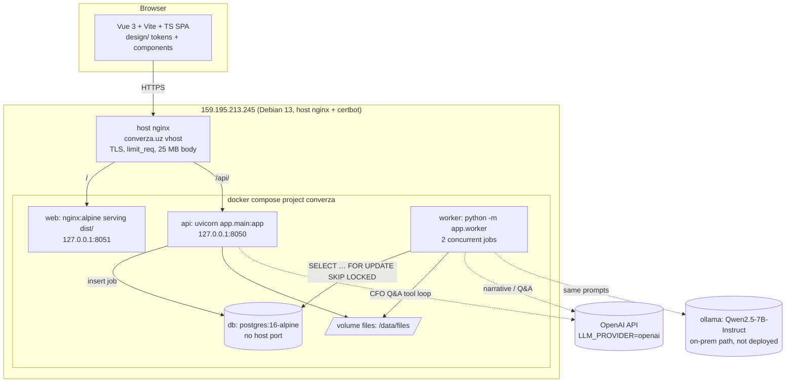

# 01 — Architecture

Backend follows `ARCHITECTURE.md` (the FastAPI + PostgreSQL + JWT + Alembic + uv blueprint) exactly: sync handlers, `BaseModel` (int `id` internal, `uuid` public), services own transactions plus audit, scopes not role names, `AppException` error body, `/api/v1/...` snake_case.

## System diagram

## Components

| Component | Tech | Responsibility |
|---|---|---|
| `web` | Vue 3, Vite, TS, vue-router, pinia; plain CSS tokens from `design/DESIGN.md`; hand-rolled SVG charts | screens from `design/reference/*.dc.html`, plus a new `/analyse` public page built from the same components |
| `api` | FastAPI per blueprint | auth, uploads, job creation, read models, officer actions, CFO Q&A loop (synchronous, ≤ 20 s) |
| `worker` | same image, `python -m app.worker` | pipeline stages; one asyncio loop, `asyncio.to_thread` per job, `WORKER_CONCURRENCY=2` |
| `db` | Postgres 16 | everything, including the job queue (no Redis) |
| files | local volume `/data/files/{document_uuid}/original.ext`, `pages/{n}.png` | originals plus 150-dpi page renders for the evidence pane |
| OCR | Tesseract 5 (`tesseract-ocr-{uzb,uzb-cyrl,rus,eng}`) via `pytesseract`, OpenCV preprocessing | scans and photos |
| Parsing | `pdfplumber`, `pypdfium2` (render), `openpyxl`, `rapidfuzz`, `scikit-learn` | |
| LLM | `openai` SDK behind `app/modules/llm/provider.py` | only in narrative, CFO Q&A and unmapped-line fallback |

## Modules `app/modules/*`

| Module | Owns tables | Key endpoints (`/api/v1`) | Scopes |
|---|---|---|---|
| `auth`, `users`, `audit` | users, audit_log | blueprint, plus `POST /auth/demo {role}` (when `DEMO_LOGIN_ENABLED`) | — / `audit:read` |
| `jobs` | jobs | `GET /jobs/{uuid}` (stage, progress, error) | `document:read` |
| `documents` | documents, pages | `POST /documents` (multipart), `GET /documents/{uuid}`, `GET /documents/{uuid}/pages/{n}.png`, `GET /documents/{uuid}/original` | `document:read/write` |
| `analyse` (public) | — (uses documents with `owner_kind=public`) | `POST /analyse` (no auth, rate-limited), `GET /analyse/{uuid}` | public |
| `extraction` | facts (kind=extracted) | `GET /documents/{uuid}/facts` | `document:read` |
| `statements` | transactions | `GET /documents/{uuid}/transactions?category=` | `document:read` |
| `reconcile` | findings | `GET /applications/{uuid}/findings` | `application:read` |
| `ratios` | facts (kind=computed) | `GET /applications/{uuid}/ratios` | `application:read` |
| `llm` | llm_calls, narrative_runs | `GET /applications/{uuid}/narrative`, `POST …/narrative:regenerate`, `GET/PUT /settings/llm` (on/off) | `application:read`, `settings:write` |
| `applications` | applications, application_documents, decisions | `POST /applications`, `POST /applications/{uuid}/documents`, `POST …:analyse`, `POST …/decision` | `application:read/write`, `decision:write` |
| `borrowers` | borrowers, loans, repayments | `GET /borrowers?status=`, `GET /borrowers/{uuid}` | `borrower:read` |
| `monitoring` | monitoring_runs, monitoring_results | `POST /monitoring/runs`, `GET /monitoring/runs/latest`, `GET /portfolio/summary` | `monitoring:read/run` |
| `reviews` | fact_reviews | `POST /facts/{uuid}/review {action: verify\|correct\|flag, value?, note}` | `fact:review` |
| `cfo` | cfo_threads, cfo_messages | `POST /cfo/threads/{uuid}/messages` | `cfo:use` |
| `system` | — | `GET /version` (git sha, built_at, deployed_at), `GET /metrics/eval` (latest eval JSON) | public |

Roles → scopes: `officer` (all bank scopes plus `fact:review`, `decision:write`), `owner` (document, cfo, own borrower only), `admin` (all), `demo_viewer` (read-only bank and owner; used by `/auth/demo`).

## Data model

All tables inherit `id int PK`, `uuid uuid unique`, `created_at`, `updated_at` (blueprint §5). Those four columns are not repeated below.

### borrowers
| field | type | default | foreign key | notes |
|---|---|---|---|---|
| name | String(255) | — | | "Farovon Savdo MChJ" |
| stir | String(9) | — | | unique; `^[2-7]\d{8}$` |
| industry, region | String(128) | "" | | |
| employees | Integer | null | | |
| owner_user_id | Integer | null | users.id SET NULL | owner surface binding |
| is_synthetic | Boolean | true | | declared on screen |

### loans
| field | type | default | foreign key | notes |
|---|---|---|---|---|
| borrower_id | Integer | — | borrowers.id CASCADE | |
| contract_no | String(32) | — | | "2025-0882" |
| original_amount, outstanding | Numeric(18,2) | — | | thousand UZS |
| installment | Numeric(18,2) | — | | |
| due_day | SmallInteger | — | | |
| term_months, paid_count | SmallInteger | — | | |
| disbursed_on, maturity_on | Date | — | | |
| collateral | JSON | {} | | |

### repayments
| field | type | default | foreign key | notes |
|---|---|---|---|---|
| loan_id | Integer | — | loans.id CASCADE | |
| n | SmallInteger | — | | |
| due_on, paid_on | Date | paid null | | days_late is derived |
| source_txn_id | Integer | null | transactions.id SET NULL | matched from a statement when available |

### applications
| field | type | default | foreign key | notes |
|---|---|---|---|---|
| number | String(16) | — | | "APP-2026-0931", unique |
| borrower_id | Integer | — | borrowers.id CASCADE | |
| requested_amount | Numeric(18,2) | — | | from the application form fact, else manual entry |
| term_months | SmallInteger | — | | |
| purpose | String(255) | "" | | |
| status | String(32) | "processing" | | processing / in_review / waiting_on_applicant / decided |
| received_on | Date | — | | SLA day = working days since received |
| analysed_at | DateTime(tz) | null | | |

### application_documents
| field | type | default | foreign key | notes |
|---|---|---|---|---|
| application_id | Integer | — | applications.id CASCADE | |
| document_id | Integer | — | documents.id CASCADE | unique pair |
| required_type | String(32) | null | | form1 / form2 / statement / application / tax_declaration; null row = missing |

### documents
| field | type | default | foreign key | notes |
|---|---|---|---|---|
| filename | String(255) | — | | as uploaded |
| sha256 | String(64) | — | | duplicate detection (rule R12) |
| mime, size_bytes | String(64), BigInteger | — | | |
| owner_kind | String(16) | "bank" | | bank / owner / public |
| borrower_id | Integer | null | borrowers.id SET NULL | |
| uploaded_by | Integer | null | users.id SET NULL | null for public |
| doc_type | String(32) | "unknown" | | form1, form2, bank_statement, loan_application, tax_declaration, invoice, sales_ledger, unknown |
| type_confidence | Float | 0 | | |
| language | String(16) | "" | | uz_latn / uz_cyrl / ru / en / mixed |
| period_start, period_end | Date | null | | |
| text_layer | Boolean | false | | false means OCR |
| status | String(24) | "queued" | | queued / processing / analyzed / clarification / failed |
| failure_cause | Text | "" | | human sentence, e.g. "Image 640×480, blur score 31 < 80" |
| summary | JSON | {} | | per-type summary for the file row |
| expires_at | DateTime(tz) | null | | public uploads purged after 24 h |

### pages
| field | type | default | foreign key | notes |
|---|---|---|---|---|
| document_id | Integer | — | documents.id CASCADE | |
| n | SmallInteger | — | | 1-based; unique (document_id, n) |
| width, height | Float | — | | PDF points or px |
| image_path | String(512) | — | | 150-dpi PNG |
| ocr_used | Boolean | false | | |
| ocr_mean_conf, skew_deg, blur_score | Float | null | | quality gate inputs |
| words | JSON | [] | | `[text,x0,y0,x1,y1,conf]`; source for passages |

### facts (the evidence store)
| field | type | default | foreign key | notes |
|---|---|---|---|---|
| key | String(24) | — | | short citable id `f_7k2m9q`, unique; what the LLM cites |
| kind | String(16) | — | | extracted / computed / aggregate (transaction sums) |
| document_id | Integer | null | documents.id CASCADE | null for computed |
| application_id | Integer | null | applications.id CASCADE | scope for computed facts |
| borrower_id | Integer | null | borrowers.id CASCADE | |
| field | String(64) | — | | canonical: `form2.010.net_revenue` |
| line_code | String(8) | null | | "010" |
| period_label | String(16) | — | | FY2025 / H1-2026 / 2026-09 / cur / prev column |
| value | Numeric(20,4) | — | | canonical unit |
| unit | String(16) | "kUZS" | | kUZS / UZS / ratio / pct / days / count |
| printed | String(64) | "" | | raw text as printed, "9 842 316" |
| page_n | SmallInteger | null | | |
| bbox | JSON | null | | [x0,y0,x1,y1] value cell |
| label_bbox | JSON | null | | row label, for highlighting the whole row |
| passage | Text | "" | | the row ±1 line, for the Mono passage |
| confidence | Float | — | | 0–1; see 02 §Confidence |
| method | String(24) | — | | dictionary / fuzzy / llm_fallback / ocr+dictionary / rule / compute |
| formula | Text | "" | | for computed: `f_a / f_b` |
| inputs | JSON | [] | | fact keys used by computed facts |
| status | String(16) | "auto" | | auto / verified / corrected / flagged |

### transactions
| field | type | default | foreign key | notes |
|---|---|---|---|---|
| document_id | Integer | — | documents.id CASCADE | |
| row_n | Integer | — | | xlsx row, used for the citation |
| booked_on | Date | — | | |
| amount | Numeric(18,2) | — | | UZS, signed (+ inflow) |
| counterparty | String(255) | "" | | |
| counterparty_stir | String(9) | null | | regex |
| account | String(20) | null | | 20-digit account |
| purpose | Text | "" | | raw purpose text |
| category | String(32) | "other" | | see 02 §4 |
| category_source | String(8) | — | | rule / model / user |
| category_conf | Float | — | | |
| recurring_group | String(32) | null | | e.g. `loan:2024-1177`, `salary` |

### findings
| field | type | default | foreign key | notes |
|---|---|---|---|---|
| application_id | Integer | null | applications.id CASCADE | |
| borrower_id | Integer | null | borrowers.id CASCADE | monitoring findings |
| rule_id | String(8) | — | | R01…R12, M01…M06 |
| severity | String(8) | — | | attn / watch / neutral / info |
| label | String(48) | — | | "Undeclared obligation" |
| title | String(255) | — | | rendered from the rule template with fact values |
| detail | Text | — | | template text; numbers come only from facts |
| evidence | JSON | [] | | fact keys |
| params | JSON | {} | | tolerance, observed delta |
| state | String(16) | "open" | | open / resolved / dismissed (by officer, audited) |

### llm_calls
| field | type | default | foreign key | notes |
|---|---|---|---|---|
| provider, model | String(32), String(64) | — | | |
| purpose | String(24) | — | | narrative / cfo / unmapped_line / unknown_doc |
| prompt_tokens, completion_tokens | Integer | 0 | | cost source for 08 |
| latency_ms | Integer | — | | |
| ok | Boolean | — | | |

### narrative_runs
| field | type | default | foreign key | notes |
|---|---|---|---|---|
| application_id / borrower_id | Integer | null | CASCADE | |
| attempt | SmallInteger | 1 | | 1..3 |
| mode | String(16) | — | | llm / template (LLM off or all attempts rejected) |
| fact_set | JSON | — | | facts JSON sent (ids and values) |
| output | Text | — | | markdown with `[f_…]` cites |
| verifier_report | JSON | — | | `{numbers:[…], unmatched:[…], uncited_sentences:[…], ok}` |
| accepted | Boolean | — | | shown only if true |
| llm_call_id | Integer | null | llm_calls.id SET NULL | |

### jobs
| field | type | default | foreign key | notes |
|---|---|---|---|---|
| kind | String(32) | — | | analyse_document / analyse_application / monitoring_run / narrative |
| payload | JSON | — | | `{document_uuid}` etc. |
| status | String(16) | "queued" | | queued / running / done / failed |
| stage | String(32) | "" | | classify / parse / ocr / extract / normalise / reconcile / ratios / narrative |
| progress | SmallInteger | 0 | | 0–100 |
| attempts | SmallInteger | 0 | | max 2 |
| locked_at, started_at, finished_at | DateTime(tz) | null | | |
| stage_timings | JSON | {} | | ms per stage; source for p50/p95 |
| error | Text | "" | | |
| deadline_at | DateTime(tz) | null | | public jobs: created + 55 s |

### monitoring_runs / monitoring_results
| field | type | default | foreign key | notes |
|---|---|---|---|---|
| runs.started_at, finished_at | DateTime(tz) | — | | |
| runs.thresholds | JSON | — | | snapshot of disclosed thresholds used |
| results.run_id | Integer | — | monitoring_runs.id CASCADE | |
| results.borrower_id | Integer | — | borrowers.id CASCADE | |
| results.status | String(8) | — | | stable / watch / attn |
| results.reason | String(255) | — | | built from the triggered indicators |
| results.indicators | JSON | — | | `{M01:{value,threshold,triggered,evidence}}` |
| results.prev_status | String(8) | null | | for "status changes, last 7 days" |

### decisions, fact_reviews, cfo_*
| field | type | default | foreign key | notes |
|---|---|---|---|---|
| decisions.application_id | Integer | — | applications.id CASCADE | |
| decisions.officer_id | Integer | — | users.id SET NULL | |
| decisions.outcome | String(24) | — | | recommend / decline / request_info (the officer's words; the system never fills it) |
| decisions.reasoning | Text | — | | required, min 20 chars |
| decisions.evidence_reviewed | JSON | — | | fact keys the officer opened, from the client log |
| fact_reviews.fact_id | Integer | — | facts.id CASCADE | |
| fact_reviews.action | String(8) | — | | verify / correct / flag |
| fact_reviews.old_value, new_value | Numeric(20,4) | null | | correction creates a new fact version; reconciliation is re-run |
| cfo_threads.borrower_id | Integer | — | borrowers.id CASCADE | |
| cfo_messages.role, content, citations, tool_trace | String, Text, JSON, JSON | | cfo_threads.id CASCADE | `tool_trace` shown under "How this was computed" |

`audit_log` per blueprint §10. Additionally logged: fact review, finding state change, decision, LLM on/off, narrative accept/reject (actor `system`), public upload (actor `public`, IP hash).

## Job and worker design

- Enqueue: the service inserts a `jobs` row in the same transaction as the document.
- Claim: `UPDATE jobs SET status='running', locked_at=now(), attempts=attempts+1 WHERE id = (SELECT id FROM jobs WHERE status='queued' ORDER BY (kind='analyse_document' AND payload->>'public'='true') DESC, id FOR UPDATE SKIP LOCKED LIMIT 1) RETURNING *`. Public jobs jump the queue.
- Run: `asyncio.to_thread(run_job, id)`, one DB session per job; each stage writes `stage`, `progress` and the `stage_timings[stage]` delta and commits, so the UI polls real progress.
- Stale lock: `running` with `locked_at < now()-5 min` → requeue (attempts < 2) or `failed`.
- Deadline: if `deadline_at` passes, the job stops at the next stage boundary, marks the document `analyzed` with `summary.partial=true`, and returns what exists. The public path always returns something true.
- The loop never dies (blueprint §13). Tests run the job function directly (`WORKER_ENABLED=false`).

## LLM provider switch

| Setting | Values | Default |
|---|---|---|
| `LLM_PROVIDER` | openai / anthropic / ollama / none | openai |
| `LLM_MODEL` | provider model id | `gpt-4.1-mini` (verify availability at T-023; any current small OpenAI model with tool calls) |
| `LLM_BASE_URL` | ollama `http://ollama:11434/v1` (OpenAI-compatible) | — |
| `LLM_TIMEOUT_S` | | 20 |
| runtime flag `llm_enabled` | DB `settings` row, UI toggle "LLM off", audited | true |

One interface: `complete(messages, tools=None, json_schema=None) -> LLMResult(text, tool_calls, usage)`. Prompts live in `app/modules/llm/prompts/*.md`, identical for every provider. With LLM off or provider `none`: extraction, reconciliation, ratios, monitoring and alerts are unchanged (no LLM in those paths). The narrative uses the deterministic template. CFO answers "LLM is off — here are the facts that match your question" plus a fact table.

## Perimeter / on-prem design (for MKBANK and Central Bank)

| Concern | Prototype (converza.uz) | Bank deployment |
|---|---|---|
| Network | public HTTPS | inside the bank LAN, no egress; same compose file |
| LLM | OpenAI API, facts JSON only (no raw documents, no names when `LLM_REDACT=true`: borrower name → "the borrower", STIR dropped) | `LLM_PROVIDER=ollama`, Qwen2.5-7B-Instruct Q4_K_M on 1× 24 GB GPU; same prompts, same verifier |
| Data | synthetic only; public uploads purged after 24 h | Postgres in the bank DC; files on bank storage |
| Identity | local JWT users | JWT kept; SSO via the bank's IdP is a pilot item |
| Audit | `audit_log`, `narrative_runs`, `llm_calls`, `decisions` | exported to the bank's SIEM; read-only role `audit:read` for CB inspectors |

## Human-in-the-loop points

| # | Point | Mechanism |
|---|---|---|
| H1 | Low-confidence extraction (< 0.80) | document `clarification`; candidate values card; the choice is a `fact_review(correct)` |
| H2 | Every finding | officer resolves or dismisses with a note (audited) |
| H3 | Any fact | verify / correct / flag from the evidence pane; a correction re-runs reconciliation and ratios |
| H4 | Narrative | labelled "AI draft, verified numbers"; rejected drafts are visible in the review trail |
| H5 | Decision | only a human writes `decisions`; the reasoning text is mandatory; the evidence opened is attached |
| H6 | Monitoring status | the officer records the review outcome; the system status stays separate from the officer's assessment |
