# 04 — Build plan

**Rule:** when a task is done, tick it and append the date and time: `- [x] **T-012** … ✅ 2026-10-10 19:05`. A task is done only when its acceptance criteria hold **on https://converza.uz** (or in CI, for non-UI tasks).

## Tracks (team members claim one at kickoff, 17:15)

| Track | Scope |
|---|---|
| **A** | core backend: blueprint skeleton, models, jobs/worker, APIs, LLM/verifier, monitoring |
| **D** | pipeline engines: classify, parse, OCR, extraction, statements, rules |
| **B** | frontend: shell, components, screens |
| **C** | infra + data: DNS, deploy, CI, dictionary, generator, eval, demo, deck |

With 3 people, D merges into A, and cut-list items 1–4 are applied at 17:15 rather than when slipping.

## Timeline (2026-10-10, UTC+5)

```mermaid
gantt
  dateFormat HH:mm
  axisFormat %H:%M
  section Phases
  P1 Live skeleton      :p1, 17:15, 75m
  P2 Document→evidence  :p2, after p1, 90m
  P3 Loan file          :p3, after p2, 90m
  P4 Monitoring+CFO     :p4, after p3, 60m
  P5 Harden+freeze      :p5, after p4, 45m
  Buffer                :crit, after p5, 30m
  Submit                :milestone, 00:00, 0m
```

Feature freeze **22:30** · Code freeze **23:15** (tag `v1.0`, last deploy) · Buffer 23:15–23:45 (deck/video only) · Submission by **2026-10-11 00:00**.

---

## P1: Live skeleton (17:15–18:30) → **M1: https://converza.uz shows the shell and `/kit`; `/api/v1/version` returns the deployed git SHA; deployed by GitHub Actions**

- [x] **T-001** Point DNS to our server · C · 0.1h · deps — · AC: at ahost.uz, `converza.uz` and `www` A records = 159.195.213.245, TTL 300; `dig +short converza.uz` from 2 resolvers (1.1.1.1, 8.8.8.8) returns it. **Do this first. Certbot (T-006) is blocked until it holds.** · Files: — ✅ 2026-10-10 17:20
- [x] **T-002** GitHub repo `converza` + push · C · 0.1h · deps — · AC: repo exists (public at submission); `main` protected from force-push; `CLAUDE.md`, `design/`, `docs/` pushed · Files: `.gitignore`, `README.md` ✅ 2026-10-10 17:25 (existing repo Az1mbek-Xak1mov/hackaton_wiut used)
- [x] **T-003** Backend skeleton per blueprint · A · 0.5h · deps T-002 · AC: `uv run pytest -q` green; `/health`, `/api/v1/version`, login/refresh/me, `POST /auth/demo` work; Dockerfile installs `tesseract-ocr tesseract-ocr-uzb tesseract-ocr-uzb-cyrl tesseract-ocr-rus tesseract-ocr-eng libgl1`; `tesseract --list-langs` in the image shows all 4 · Files: `app/core/*`, `app/main.py`, `app/modules/{auth,users,audit,system}/*`, `Dockerfile`, `pyproject.toml`, `uv.lock`, `.env.example`, `tests/conftest.py` ✅ 2026-10-10 17:53 (pytest green; image built locally: tesseract eng/osd/rus/uzb/uzb_cyrl; /health, /version, /auth/demo verified in the container)
- [x] **T-004** Frontend skeleton + shell + primitives + `/kit` · B · 1.25h · deps T-002 · AC: Vue 3 + Vite + TS; `src/styles/tokens.css` from DESIGN.md; Plex Sans/Mono; PrototypeStrip with the declared-synthetic text; TopBar (wordmark **Converza**), SideNav (officer/owner), AppLayout wrapping at 720 px; Panel, Pill, Button, EvidenceChip, DataTable, Eyebrow, FigureStrip; `/kit` mirrors `DesignSystem.dc.html`; `npm run build` clean · Files: `web/**` ✅ 2026-10-10 18:02 (local; deploy check by lead)
- [x] **T-005** Production compose + server dir · C · 0.3h · deps T-003 · AC: `/srv/converza/{repo,.env,data,deploys.log}` on the server; `compose.prod.yml` services `db`, `api` (127.0.0.1:8050), `worker`, `web` (127.0.0.1:8051); mem limits api 1g, worker 2g, db 512m, web 64m; volumes `db-data`, `files`; `docker compose ps` all healthy · Files: `compose.prod.yml`, `web/Dockerfile`, `web/nginx.conf` ✅ 2026-10-10 18:09 (prod compose up; deploys.log active)
- [x] **T-006** nginx vhost + TLS · C · 0.3h · deps T-001, T-005 · AC: `/etc/nginx/sites-available/converza.uz.conf` (see 06); `sudo nginx -t` OK before reload; `certbot --nginx -d converza.uz -d www.converza.uz`; https A-grade redirect; **other vhosts still answer 200** (check satstars.uz, goedu) · Files: `deploy/nginx/converza.uz.conf` (copy in repo) ✅ 2026-10-10 17:40
- [ ] **T-007** GitHub Actions deploy · C · 0.5h · deps T-005 · AC: `.github/workflows/deploy.yml`: on push to `main` → backend tests + `npm run build` → ssh deploy (06) → curl `/api/v1/version` equals `$GITHUB_SHA` → append to `deploys.log`; uses `environment: production` so the repo's Deployments tab lists every deploy · Files: `.github/workflows/deploy.yml`, `deploy/deploy.sh`
- [x] **T-008** Data model + initial migration · A · 0.5h · deps T-003 · AC: every table in 01 exists via `alembic upgrade head` on Postgres; SQLite `create_all` in tests; scopes and roles added · Files: `app/modules/*/models.py`, `app/models/__init__.py`, `app/alembic/versions/0001_initial.py`, `app/core/scopes.py` ✅ 2026-10-10 17:47 (alembic 0001 applied on Postgres 16 locally; `alembic check` clean)
- [x] **T-009** Job queue + worker · A · 0.25h · deps T-008 · AC: `jobs` claim with `SKIP LOCKED`; concurrency 2; stage/progress/timings persisted; stale-lock requeue; test runs 3 jobs on 2 workers without double-claim · Files: `app/modules/jobs/*`, `app/worker.py`, `tests/test_jobs.py` ✅ 2026-10-10 17:47 (SKIP LOCKED verified with 2 threads on Postgres: tests/test_jobs.py)
- [x] **T-010** Line-code dictionary v1 · D · 0.75h · deps — · AC: `forms.yaml` with 26 Form 1 + 19 Form 2 lines, 4 label languages, `sum_of` relations; header cites the lex.uz source; design codes 010/020/030/040/120/240/270/140/390/400/490/600 present; unit test: sums are consistent on a synthetic balanced form · Files: `app/pipeline/dictionary/forms.yaml`, `app/pipeline/dictionary/__init__.py`, `tests/test_dictionary.py` ✅ 2026-10-10 17:24 (48 F1 + 26 F2 lines; verified against lex.uz/docs/771825, 2019 edition: finance costs = 170, profit tax = 250, total L+E = 780, line 080 removed; tests in tests/pipeline/test_dictionary.py)
- [x] **T-011** Classifier + text-PDF/XLSX parser · D · 0.5h · deps T-010 · AC: Word/Row model; `classify()` on 6 sample files gives the right type; xlsx header detection on both bank layouts · Files: `app/pipeline/{classify,parse_pdf,parse_xlsx,rows}.py`, `tests/test_classify.py` ✅ 2026-10-10 18:10 (types 15/16 on hero bundles, the miss is the unreadable 640×480 JPG; tests in tests/pipeline/test_classify*.py, test_parse.py)

## P2: Document → evidence (18:30–20:00) → **M2: on converza.uz/analyse, uploading a Form 2 PDF (text or 150-dpi scan) shows the extracted lines; clicking a value opens the page image with the cell highlighted and the passage. A legitimate live demo on its own.**

- [ ] **T-012** Statutory extraction · D · 1.0h · deps T-011, T-019 (first output: clean Form 1/2 PDFs by 19:00) · AC: on 10 dev bundles Form 1/2 clean, field F1 ≥ 0.95 (printed by `eval/run.py --split dev --stage extract`); facts carry page, bbox, passage, conf, method · Files: `app/pipeline/extract_forms.py`, `tests/test_extract_forms.py`
- [x] **T-013** OCR path · D · 0.5h · deps T-011 · AC: deskew/binarise/OSD; quality gate writes `failure_cause`; the hero F1 2025 150-dpi scan extracts ≥ 22/26 lines; per-page OCR ≤ 6 s on the server · Files: `app/pipeline/ocr.py`, `tests/test_ocr.py` ✅ 2026-10-10 18:10 locally (hero Balans_2025 150-dpi scan: 59/60 cells; 3.7 s/page on a 12-core laptop — server timing to be measured after deploy; tests in tests/pipeline/test_ocr.py)
- [x] **T-014** Documents API + analyse_document job · A · 0.5h · deps T-009, T-012 · AC: upload → job → stages classify/parse/ocr/extract persisted; `pages` PNGs at 150 dpi; `GET /documents/{uuid}/pages/{n}.png`; `GET /documents/{uuid}/facts` · Files: `app/modules/{documents,extraction}/*`, `app/modules/jobs/runner.py` ✅ 2026-10-10 17:47 (real pipeline on a generated Form 2 locally: 52 facts with page/bbox/PNG; prod check at deploy)
- [x] **T-015** Public `/analyse` API · A · 0.5h · deps T-014 · AC: `POST /api/v1/analyse` without auth (20 MB, pdf/xlsx/jpg/png), `deadline_at` +55 s, queue priority; `GET /analyse/{uuid}` returns status, stage, progress, doc type + reason, facts, findings, "what I could read" for unknown types; 24 h purge task; test for an unknown PDF returns 200 with content · Files: `app/modules/analyse/*`, `tests/test_analyse.py` ✅ 2026-10-10 17:47 (tests/test_analyse.py incl. unknown + unsupported + missing-pipeline; prod check at deploy)
- [x] **T-016** `/analyse` page · B · 0.75h · deps T-004, T-015 · AC: dropzone + file input + 3 sample-bundle download links; real stage progress via 1 s polling; result: type pill + reason, extracted table (line · printed label · interpreted · cur · prev · conf pill), unmapped lines, failure cause with exits; works at 390 px width · Files: `web/src/pages/Analyse.vue`, `web/src/api/*` ✅ 2026-10-10 18:02 (local; deploy check by lead)
- [x] **T-017** EvidencePane + page highlight · B · 0.75h · deps T-014 · AC: chip click → pane shows doc, page/line, page PNG with an SVG bbox overlay (scaled), Mono passage with the matched value highlighted, interpretation, actions Verify/Correct/Flag (call `/facts/{uuid}/review`) · Files: `web/src/components/{EvidenceChip,EvidencePane,PageHighlight}.vue`, `web/src/stores/evidence.ts` ✅ 2026-10-10 18:02 (local; deploy check by lead)
- [x] **T-018** Fact review API · A · 0.25h · deps T-014 · AC: verify/correct/flag audited; a correction re-runs dependent rules and ratios for the application · Files: `app/modules/reviews/*` ✅ 2026-10-10 17:47 (verify/correct/flag audited; correct re-enqueues the application analysis)
- [x] **T-019** Generator v1 + hero bundles · C · 1.0h · deps T-010 · AC: clean Form 1/2 PDFs + truth delivered to D by 19:00, then: Form 1/2 PDFs in 3 layouts × 3 languages + application PDF; `hero_farovon`, `hero_navroz`, `hero_zilola` reproduce the demo-data.json inputs (03); noise variants incl. 150 dpi scan and photo; `truth.json` per bundle · Files: `eval/generator/**` ✅ 2026-10-10 17:59
- [x] **T-020** Three public sample bundles · C · 0.25h · deps T-019 · AC: `web/public/samples/{farovon_loan_file,navroz_owner_docs,zilola_monitoring}.zip` + single-file samples (one Form 2 PDF, one statement xlsx, one photo JPG) linked on `/analyse`; total < 15 MB · Files: `web/public/samples/*` ✅ 2026-10-10 17:59

## P3: Loan file (20:00–21:30) → **M3: `/bank/applications/APP-2026-0931` built by uploading the 6 hero files through the pipeline: 3 issues, extracted figures, ratios incl. DSCR 1.47 → 1.04, a verified narrative with chips. The "LLM off" toggle still leaves issues, figures and ratios working.**

- [x] **T-021** Statement normaliser + categoriser + recurring detection · D · 0.75h · deps T-011, T-019 · AC: train on the train split; categoriser accuracy on dev printed; hero statement → detects `loan:2024-1177` (8 × 18.5 mln, day 20) and salary/tax groups; aggregate facts with row-range evidence · Files: `app/pipeline/statements/*`, `eval/train_categoriser.py`, `app/pipeline/statements/model.joblib` ✅ 2026-10-10 18:02 (dev split, 40 bundles / 16 616 rows: rules-only 98.7%, model-only 99.2%, rules→model 99.1% accuracy; hero_farovon loan:2024-1177 8 × 18.5 mln day 20, month-end balances exact; metrics in `app/pipeline/statements/model_metrics.json`)
- [x] **T-022** Rule library R01–R12 · D · 0.75h · deps T-012, T-021 · AC: one unit test per rule (fires / doesn't fire); hero_farovon yields exactly R06 attn, R07 watch, R10 neutral · Files: `app/pipeline/rules/*`, `tests/test_rules.py` ✅ 2026-10-10 18:02 (`tests/pipeline/test_rules.py`; hero_farovon truth figures → exactly R06/R07/R10; train+dev truth figures: 169/169 planted findings, 0 false positives)
- [x] **T-023** LLM provider + narrative + verifier · A · 1.0h · deps T-008 · AC: `LLM_PROVIDER=openai|anthropic|ollama|none`; verifier unit tests (accepts cited correct numbers, rejects an invented number, rejects a number cited to the wrong fact, rejects "approve"); 3-attempt loop + template fallback; `llm_calls` tokens logged; runtime toggle `PUT /settings/llm` audited · Files: `app/modules/llm/*`, `app/pipeline/verify.py`, `app/modules/llm/prompts/*.md`, `tests/test_verify.py` — verifier part done 2026-10-10 18:02: `app/pipeline/verify.py` + `tests/pipeline/test_verify.py` (accepts cited numbers, rejects invented / wrong-fact / uncited / unknown-id / approve); provider, 3-attempt loop and toggle remain with track A ✅ 2026-10-10 18:17 (provider openai/anthropic/ollama/none + llm_calls log; verified narrative ≤3 attempts → template; tests/test_llm.py with a fake provider; no OpenAI key used locally, so no live-provider run yet)
- [x] **T-024** Ratios · A · 0.25h · deps T-012 · AC: all ratios in 02 §6 as computed facts with formula + inputs; hero: current 1.48, quick 0.75, DSCR 1.47 → 1.04 · Files: `app/pipeline/ratios.py`, `tests/test_ratios.py` ✅ 2026-10-10 18:02 (`tests/pipeline/test_ratios.py`; hero: 1.48 / 0.75 / 6.0% / 0.85 / 31 days / 5.0% / DSCR 1.47 → 1.04)
- [x] **T-025** Applications API + analyse_application job · A · 0.25h · deps T-022, T-023, T-024 · AC: create application, attach documents, `:analyse` → rules → ratios → narrative; status/SLA day; decision endpoint requires reasoning; review trail = audit + narrative_runs · Files: `app/modules/applications/*` ✅ 2026-10-10 17:47 (7-document generated bundle → in_review in ~20 s locally with real rules/ratios/template narrative)
- [x] **T-026** Loan review screen · B · 1.25h · deps T-017, T-025 · AC: `/bank/applications/:id` per `LoanReview.dc.html` + SCREENS §06 with live API data: request summary, issues, extracted figures with chips, 6 ratio boxes, indicator text + disclaimer, narrative (or labelled template), documents incl. missing, sticky evidence pane, review trail, Record decision modal · Files: `web/src/pages/bank/LoanReview.vue`, `web/src/components/*` ✅ 2026-10-10 18:02 (local; deploy check by lead)
- [x] **T-027** LLM-off toggle in UI · B · 0.25h · deps T-023 · AC: TopBar switch "LLM on/off" (officer/admin); narrative panel switches to "Template summary"; nothing else changes · Files: `web/src/components/TopBar.vue` ✅ 2026-10-10 18:02 (local; deploy check by lead)
- [ ] **T-028** Demo seed through the pipeline · C · 0.5h · deps T-025, T-019 · AC: `python -m app.seed_demo` creates users (officer, owner, demo_viewer), borrowers and loan book from CSV, then **uploads the hero and portfolio files via the documents service** (jobs run them); idempotent; runs in deploy after migrations when `SEED_DEMO=true`; finishes < 15 min on the server · Files: `app/seed_demo.py`, `data/seed/**`
- [x] **T-029** Generator v2 + batch · C · 0.5h · deps T-019 · AC: statements (2 layouts), planted contradictions, 200 bundles + 148 portfolio bundles generated; split dirs exist · Files: `eval/generator/**`, `data/synth/` (git-ignored; seed bundles committed under `data/seed/`) ✅ 2026-10-10 18:16

## P4: Monitoring + CFO + metrics (21:30–22:30) → **M4: `/bank` and `/bank/borrowers` show statuses computed by a monitoring run with reasons and thresholds; `/owner/cfo` answers a question with chips via tool calls; `/metrics` shows the real eval JSON. FEATURE FREEZE 22:30**

- [ ] **T-030** Monitoring run + portfolio API · A · 0.5h · deps T-021, T-024, T-028 · AC: M01–M06; status rules; `prev_status`; `/portfolio/summary`, `/borrowers?status=`; Zilola → Attention with 4 reasons · Files: `app/modules/{monitoring,borrowers}/*`
- [x] **T-031** CFO tool loop · A · 0.5h · deps T-023, T-021 · AC: tools in 02 §8; `compute` registers facts; the answer passes the verifier; the "What I can't see" box from `missing_data`; LLM off → fact table answer · Files: `app/modules/cfo/*` ✅ 2026-10-10 18:17 (POST/GET /cfo/messages: 6-call/20 s tool loop, compute registers facts, verify_cfo_answer, facts-only when off; fake-provider tests)
- [x] **T-032** Portfolio + Borrowers screens · B · 0.5h · deps T-030 · AC: `/bank` figure strip, queue, monitoring status table, new applications; `/bank/borrowers` with status chips + `?status=`; side-nav threshold disclosure + calibration label · Files: `web/src/pages/bank/{Portfolio,Borrowers}.vue` ✅ 2026-10-10 18:02 (local; deploy check by lead)
- [ ] **T-033** AI CFO screen · B · 0.5h · deps T-031 · AC: `/owner/cfo` conversation + evidence pane + composer + 3 suggestions; "How this was computed" expander shows the tool trace · Files: `web/src/pages/owner/AICFO.vue` — UI built and type-checked (local); answer/tool-trace rendering untested until T-031 replaces the 501 stub
- [ ] **T-034** Eval run + report + `/metrics` · D · 0.5h · deps T-022, T-029 · AC: `eval/run.py --split test` + hard → JSON in `eval/results/`; `docs/EVAL.md`; `/metrics` page renders the JSON (P/R tables, latency p50/p95 from server jobs, cost/app); `docs/KNOWN-FAILURES.md` ≥ 8 entries · Files: `eval/{run,metrics,report}.py`, `docs/EVAL.md`, `docs/KNOWN-FAILURES.md`, `web/src/pages/Metrics.vue`
- [ ] **T-035** Timed trial: officer-minutes · C · 0.5h · deps T-026 · AC: 2 team members × 3 bundles (manual = PDF + Excel to fill the extracted-figures table and check R01/R05/R06/R07/R10, vs Converza review + verify); minutes recorded in `docs/plan/trial.csv`; median per arm into 08 · Files: `docs/plan/trial.csv`
- [x] **T-036** Hard cases H01–H20 · D · 0.5h (with T-034) · deps T-019 · AC: files + truth in `data/hard/`; included in the eval run · Files: `data/hard/**` ✅ 2026-10-10 17:59

## P5: Harden + freeze (22:30–23:15)

- [ ] **T-037** Jury contingency matrix on prod · all · 0.25h · deps M4 · AC: every branch of 05 §Contingency tested from 2 phones (Android + iOS) on converza.uz; results ticked in 05 · Files: `docs/plan/05-DEMO.md`
- [ ] **T-038** Backup video · C · 0.25h · deps T-037 · AC: 3-min screen recording of the 05 click path on prod (OBS, 1080p) + uploaded unlisted; link in the README · Files: `README.md`
- [ ] **T-039** README for jury · C · 0.25h · deps T-034 · AC: what it is, live URL, demo logins/`Enter as officer`, how to run locally, data/licence table (03), honesty statement, metrics link · Files: `README.md`
- [ ] **T-040** Code freeze · C · 0.1h · deps all · AC: tag `v1.0` at 23:15; last green Actions deploy; `/api/v1/version` = tag SHA; screenshot of the Deployments tab saved · Files: —
- [ ] **T-041** Deck · C (+ all at 23:15) · 1.0h, from 22:00 in parallel · deps T-034, T-035 · AC: 7-min deck per 05; every number traced to `eval/results/*.json`, `trial.csv` or 08 params · Files: `docs/deck/converza.pdf`

## Buffer
23:15–23:45 deck/video only. A slipping P-task is moved to the cut list, not into the buffer.

## Cut list (drop in this order when a milestone is > 20 min late)

| # | Drop | Keeps the honesty rules because |
|---|---|---|
| 1 | Owner Health page, owner phone layout, owner Overview (`/owner`) | not rendered; nothing fake shown |
| 2 | UZ/RU UI translations (switch hidden) | EN is the project language |
| 3 | BorrowerProfile page (`/bank/borrowers/:id`) → row click opens the evidence pane with that borrower's findings | statuses stay computed |
| 4 | Sales ledger parsing / receivables aging by customer | CFO says "What I can't see: receivables by customer — upload the sales ledger" |
| 5 | Hard cases reduced to H01, H05, H15, H16, H19, H20 | metrics state n |
| 6 | Portfolio 148 bundles → 40 bundles; figures computed over 40 | the strip shows the real count |
| 7 | CFO tool loop → "LLM off"-style fact search answer only | labelled |
| 8 | LLM fallback for unmapped lines | rows listed as unmapped |
| **Never cut** | `/analyse` jury path, evidence pane, verifier, LLM-off toggle, HTTPS deploy via Actions, eval JSON for any number we state | |
