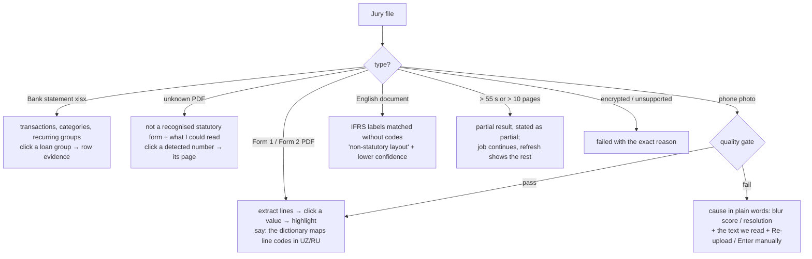

# 05 — Defence: 7-minute script

Presenter P1 talks, P2 drives the laptop (Chrome, 1440 px, zoom 110%, logged in as officer in tab 1, `/analyse` in tab 2, `/metrics` in tab 3). A phone is mirrored for the jury input. Timer visible to P1.

## Script

| Time | Block | Said (core lines) | On screen |
|---|---|---|---|
| 0:00–1:00 | **Problem / user** | "An MKBANK SME loan officer receives a PDF Form 1, a Form 2, a bank statement and an application, often scanned, in Uzbek or Russian. Retyping figures and cross-checking them is the file preparation that sits inside a review we assume takes 10 working days from complete application to decision (to be confirmed with MKBANK). After disbursement, the same documents arrive monthly and nobody reads them closely. Converza is a document-to-evidence engine: every number clicks back to its page, and the model may not state a number that isn't in the records." | slide 1 (Converza, 10x engineers, MKBANK SME Lending + CB), slide 2 (officer workflow before/after) |
| 1:00–3:00 | **Live demo** | see click path. Key line at the narrative: "This paragraph was written by a language model. The verifier checked every number against the fact store. Here's a draft it rejected." | tabs 1 → 2 |
| 3:00–5:00 | **Technology** | 8-stage pipeline; deterministic first, LLM last; line-code dictionary in 4 label languages; categoriser trained on our labelled set; 12 reconciliation rules; `compute` tool so the model can't do arithmetic; Postgres job queue; LLM switch to a local Qwen2.5-7B with the same prompts; metrics with n and the synthetic caveat | slide 3 pipeline diagram (02), slide 4 verifier example (real `narrative_runs` row), slide 5 metrics copied from `eval/results/*.json` + `/metrics` tab, slide 6 known failures |
| 5:00–6:30 | **Budget / ROI** | measured officer-minutes from the timed trial (n stated, team members not bank officers); cost per application in UZS from token logs; pilot cost table; payback at 50 applications/month (assumption) + 148 borrowers monitored | slides 7–8 from `08-BUSINESS.md` |
| 6:30–7:00 | **Next steps** | pilot month 1: real-document eval on 100 anonymised MKBANK files + threshold calibration; month 2: on-prem with a local model; month 3: monitoring for one regional office | slide 9 |

## Live demo click path (2:00 total)

| t | Action | Shows |
|---|---|---|
| 1:00 | Tab 1 `/bank` → "Farovon Savdo MChJ" in the queue | portfolio computed by the monitoring run |
| 1:10 | `/bank/applications/APP-2026-0931` | issues: Undeclared obligation (attn), Contradiction (watch), Missing document |
| 1:20 | click **9 842.3** (Net revenue FY2025) | evidence pane: Forma2_2025.pdf · p.1 · line 010, page image with the highlighted cell, Mono passage |
| 1:30 | click the chip on "Undeclared obligation" | statement rows 8 × 18.5 mln to contract 2024-1177 on the 20th; F1 line 490 = 0 |
| 1:40 | Ratios: DSCR **1.47 → 1.04** → hover the derivation | formula + input chips |
| 1:50 | AI analysis paragraph → click a chip; open the Review trail → "attempt 1 rejected: 1 unmatched number" | verifier in action |
| 2:05 | toggle **LLM off** | narrative becomes "Template summary"; issues/figures/ratios unchanged |
| 2:15 | Tab 2 `/analyse`: **jury input**. Ask a juror to upload any document, or scan the QR code on the slide to the sample bundles | live classification, stage progress, result in < 60 s |
| 2:45 | click a value in the jury's result | page highlight on their own document |
| 3:00 | → technology slides | |

If the jury declines to give a file: P2 uploads `samples/form2_scan_150dpi.pdf` from the phone.

## Jury-input contingency tree

| Branch | Say | Tested on prod (T-037) |
|---|---|---|
| Form 1/2 PDF | "Line 010 is net revenue in every language variant; the code is the key." | [ ] Android [ ] iOS |
| Bank statement | "Repeated loan payments are detected from purpose text and timing, not declared." | [ ] [ ] |
| Unknown PDF | "It tells you what it is not, and still shows what it read, with page references." | [ ] [ ] |
| Photo | "If the photo is too blurry, it says why, by the numbers, instead of guessing." | [ ] [ ] |
| English doc | "Statutory forms are the target; other layouts are matched by label with lower confidence." | [ ] [ ] |
| Slow / big | "This is a partial result; it says so." | [ ] [ ] |

Failure on stage = say what happened, open `/metrics` → Known failures, and continue. Never re-run with a prepared file and pretend it was theirs.

## Backup

| Failure | Fallback |
|---|---|
| Venue Wi-Fi down | phone hotspot (P2's phone, tested 22:45) |
| converza.uz down | backup video (T-038), 3 min, plays the same click path; say "recorded at 22:50 on the production site" |
| OpenAI down / slow | flip **LLM off** live; it's part of the story |
| Projector resolution | layout tested at 1280×720 |

## The three sample bundles (`/samples/*.zip`, linked + QR on `/analyse`)

| Bundle | Files | What a judge sees |
|---|---|---|
| `farovon_loan_file.zip` | `Ariza_FarovonSavdo.pdf`, `Balans_2025.pdf` (150 dpi scan), `Balans_1H2026.pdf`, `Forma2_2025.pdf`, `Forma2_1H2026.pdf`, `vypiska_2026.xlsx` | undeclared loan, revenue contradiction, missing tax declaration; OCR on the scan |
| `navroz_owner_docs.zip` | `bank_vypiska_2026-01_09.xlsx`, `Forma2_1yarim_2026.pdf`, `Balans_2025_skan.pdf`, `schet-faktura_0917.jpg` | categorised cash flow; 3 low-confidence cells; blurred photo rejected with a cause |
| `zilola_monitoring.zip` | `forma1_Q3-2026.pdf`, `forma2_Q3-2026.pdf`, `vypiska_2026-07_09.xlsx` | revenue −28%, receivables up, late installment → indicators |

Single files for phone tests: `form2_clean.pdf`, `form2_scan_150dpi.pdf`, `statement.xlsx`, `photo_invoice.jpg`, `english_ifrs.pdf`.
